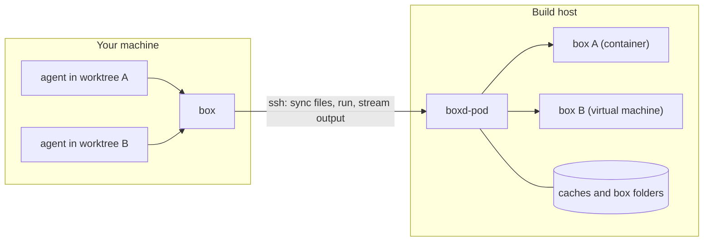
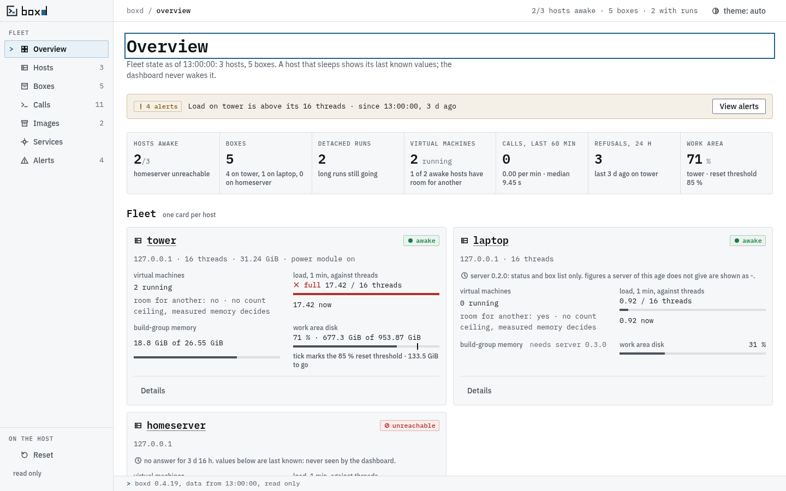

<p align="center">
  <picture>
    <source media="(prefers-color-scheme: dark)" srcset="docs/assets/logo-dark.svg">
    
  </picture>
</p>

<p align="center">
  <b>Build boxes for coding agents, on hardware you already own.</b>
</p>

<p align="center">
  <a href="LICENSE"></a>
  <a href="https://github.com/gsalucci/boxd/releases/latest"></a>
  
</p>

boxd ("boxed") moves the heavy work of coding agents off your own machine. Put `box` in front of a command
inside a git worktree and the command runs in that worktree's own box on a build server you own: the same box on
every call, with its caches kept.

```sh
box cargo test -p mycrate          # runs on the build server, in this worktree's own box
box --pull target/release make     # build there, copy the result back
box --detach make release          # a run that outlives the agent that started it
```

Ten agents in ten worktrees get ten boxes. They do not see each other's files, they cannot take the host down
together, and nothing they leave behind stays on the host for long.

## Why

Coding agents run builds and test suites all day. On your own machine that means fans, a slow desktop and agents
that step on each other. A rented runner costs money per minute and starts cold every time. Most people already
have a second machine that could do the work: an old tower, a spare laptop, a small server.

boxd turns that machine into a build host for agents:

- **One box per worktree.** The box is made on the first call and reused on the next ones. Dependency caches
  persist, so the second build is fast.
- **Containers or virtual machines.** Boxes are rootless podman containers by default. Add `--vm` and the box is
  a small virtual machine ([microsandbox](https://github.com/superradcompany/microsandbox)) with its own kernel, for
  work that needs docker, podman or root inside.
- **The host cannot be overloaded.** All boxes share one memory cap. A new virtual machine is admitted only when
  the sizes of the running ones leave room; otherwise the call is refused with a clear line, or an idle machine
  is removed first.
- **Cleanup is automatic.** An idle box is removed after 30 minutes. The box of a deleted worktree is removed with
  its files. Old folders go by age, then by disk pressure. Every removal is logged with the disk it freed.
- **Several hosts.** Register more than one build server and `box` picks one with room, and remembers it for
  that worktree.
- **A host that sleeps.** With the optional power module the host suspends after quiet minutes and wakes on the
  next `box` call (wake on network), in about 15 seconds.
- **Nothing to trust on the host.** The build account can do one thing over ssh: talk to `boxd-pod`. It holds no
  registry logins and no credentials of yours. A secret reaches a command only through `--env`, never through a
  command line, a file or a log.

## How it works



`box` syncs the files git counts as part of the worktree to the host, runs the command in the worktree's box and
streams the output back with the command's exit code; the last line on standard error is `box: exit <code> on <host>`. On the host a dedicated sshd lets the build account run only
`boxd-pod`, which makes, runs, limits and removes boxes. The protocol between the two is written down in
[`docs/pod-contract.md`](docs/pod-contract.md) and checked from both sides by the shared cases in
`contract/cases.json`.

| Package | What it is |
|---|---|
| `boxd-server` | the build host: `boxd-pod`, the build sshd, `boxd-setup`, `boxctl`, the toolbox image |
| `boxd-power` | optional: the host sleeps when idle and wakes on the next call |
| `boxd-client` | the agents' machine: `box`, `box-wake`, and a skill that teaches Claude Code to use them |

## Requirements

- **Build host:** Linux on x86_64 with podman. Packaged for Void Linux (runit) and for Debian 13 and its
  derivatives (systemd). Virtual machine boxes need `/dev/kvm`. A btrfs work area gives instant resets; any other
  file system works as a plain folder.
- **Agents' machine:** Linux with Node.js 20 or newer, ssh, rsync and git.

## Install

### 1. The build host

Built packages are attached to every release at <https://github.com/gsalucci/boxd/releases>.

On Void, use the release as a package repository. The first sync asks you to accept the signing key "boxd"; its
fingerprint is `18:b7:39:2f:ce:fb:df:54:31:9a:e3:ab:e9:fb:d4:7b`:

```sh
echo 'repository=https://github.com/gsalucci/boxd/releases/latest/download' | sudo tee /etc/xbps.d/boxd.conf
sudo xbps-install -S boxd-server
```

On Debian, download the `.deb` files of the release and install them:

```sh
sudo apt install ./boxd-server_*.deb ./microsandbox-bin_*.deb
```

(`microsandbox-bin` is optional; it adds virtual machine boxes.) Or build the packages from this repository
([Void](docs/packaging.md): `tools/build-packages`, [Debian](docs/packaging-debian.md): `tools/build-deb`) and install
`boxd-server`. Then, as root:

```sh
boxd-setup --key /path/to/agent.pub     # the public key the agents' machine logs in with
boxctl start
```

`boxd-setup` makes the build account, the work area, the podman settings and the services, and turns on virtual
machine boxes when the host can run them. It can be run again at any time. `boxctl` is the one command for the
service: `start`, `stop`, `status`, `check`, `log`, `reload`.

A host whose disk is shared with the system (a laptop with one disk): the cleanup levels are percents of the whole disk, so the
defaults (from 70 percent) would let build data grow to hundreds of gigabytes. When the work area shares its disk with `/` and
`/etc/boxd/boxd.conf` sets no level, `boxd-setup` writes `BOXD_EVICT_AT`, `BOXD_EVICT_TO` and `BOXD_KEEP_DAYS` that fit the disk
and prints what they mean; change them there. Put the work area on a btrfs subvolume of its own (`boxd-setup` does) so the system's snapshots do not copy build data. The host report shows both (`work_own`, `work_shared`, `evict_at`) and `tools/host-watch` warns.

### 2. The agents' machine

Install `boxd-client` the same way (`sudo xbps-install -S boxd-client`, or `sudo apt install ./boxd-client_*.deb`), then once per build server:

```sh
box setup <host> --hostname <address> [--port 2222] [--identity <key file>]
```

This writes the ssh entry, remembers the host as the default and installs the Claude Code skill. For a host
that sleeps, add `--wake <hardware address> --broadcast <address>`.

### 3. Use it

Inside any git worktree:

```sh
box npm test                                         # this worktree's own container box
box --vm --image localhost/toolbox docker run --rm hello-world
box --image-file ci/Containerfile make test          # the box's image built from a file in the worktree
box --vm --size small -- nproc                       # 2 processors and 2 GB; medium, large and xlarge (8 processors, 12 GB) exist
box --vm --env API_TOKEN ./deploy-check              # hand over one secret from your environment
box --detach make release                            # background run; prints how to read its log
box log <run> --state                                # still running (how old, how long its log was silent), or ended: exit code, when, how long
box log <run> --follow                               # wait for the end, exit with the run's code; last line: box: run <run> exit <code> on <host>
box --pull target/out make                           # copy results back
box --git cargo test                                 # /job/src is a git repository at this worktree's own commit
box --commit HEAD cargo test                         # run on what a fresh clone at that commit holds, not on your working folder
box --shards 5 -- npx vitest --shard={shard}/{shards}   # five boxes side by side, one line as each ends, tails of the failures
box forward 5901 5900                                # reach a port inside the box from your machine
box ps                                               # what runs in this box
box hosts                                            # every build server: asleep, awake with its load, unreachable
box hosts --pick                                     # the one server a first call would pick now; exit 75 when none has room
box stop                                             # stop this worktree's box to free memory; its files stay
box drop                                             # remove this worktree's box and its files now
box --help
```

## The dashboard

<p align="center">
  <picture>
    <source media="(prefers-color-scheme: dark)" srcset="docs/assets/dashboard-dark.png">
    
  </picture>
</p>

`dashboard/` is a small read-only web page for all your build hosts: boxes, runs, memory, disk, refusals and
removals. It asks each host over ssh with a key that may only read, never wakes a sleeping host, and ships as a
container stack ([`dashboard/stack/INSTALL.md`](dashboard/stack/INSTALL.md)). It is plain files: no build step,
no dependency, no outside request.

## Documents

| Document | What it holds |
|---|---|
| [`docs/settings.md`](docs/settings.md) | every setting of `/etc/boxd/boxd.conf` with its default |
| [`docs/pod-contract.md`](docs/pod-contract.md) | the call protocol between `box` and `boxd-pod`, and every rule of admission and cleanup |
| [`docs/packaging.md`](docs/packaging.md), [`docs/packaging-debian.md`](docs/packaging-debian.md) | building, signing and publishing the packages |
| [`docs/designs/`](docs/designs) | the designs: installed layout, choice among several hosts, dashboard |
| [`docs/development.md`](docs/development.md) | compiling and running the tests |
| [`client/skill/SKILL.md`](client/skill/SKILL.md) | what the agent is told |
| [`CHANGELOG.md`](CHANGELOG.md) | every release |

## Status

boxd runs day-long agent workloads on two build hosts, and every release is installed on both on the day it is
tagged. It is young software, made for one setup first: expect rough edges on distributions other than Void Linux
and Debian 13, and read the change log before an upgrade.

## Acknowledgements

boxd is glue around the work of others.

Shipped with boxd, under their own licenses:

- [microsandbox](https://github.com/superradcompany/microsandbox) (Apache License 2.0) runs the virtual machine boxes.
  The `microsandbox-bin` package is its unchanged release binary with its license text.
- [IBM Plex](https://github.com/IBM/plex) (SIL Open Font License 1.1) is the typeface of the dashboard; the license is
  in `dashboard/web/assets/fonts/OFL.txt`.

Used on the host or the client, installed from your distribution:

- [Podman](https://podman.io) runs the container boxes, rootless.
- [OpenSSH](https://www.openssh.com) and [rsync](https://rsync.samba.org) carry every call and every file.
- [btrfs](https://btrfs.readthedocs.io) gives the work area its instant resets.
- [Void Linux](https://voidlinux.org) and [Debian](https://www.debian.org) are the systems boxd is packaged for.
- [Node.js](https://nodejs.org) runs the client and the dashboard.

## License

[MIT](LICENSE)
